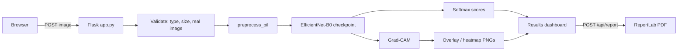
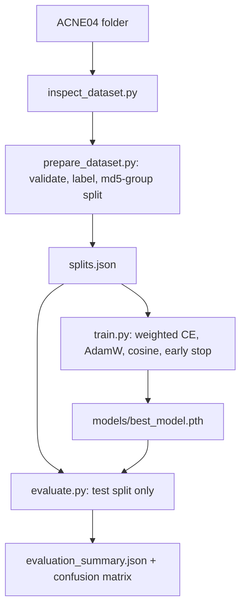

# Cutis Lens — Explainable AI-Powered Acne Detection and Skin Analysis

A Flask web app that grades acne **severity** from a facial photo with a transfer-learning CNN
(EfficientNet-B0) and explains every prediction with a **Grad-CAM heatmap**. Includes the full pipeline:
dataset inspection → leakage-safe splits → training → held-out evaluation → web app → PDF report → tests.

> **Educational prototype, not a medical device.** Output is a model prediction. See a dermatologist for any skin concern.

## Honest project status

| Component | State |
|---|---|
| Dataset inspection / preparation / splits | Implemented and tested (on a synthetic mini-dataset) |
| Web app, API, upload validation, results dashboard, PDF report | Implemented and tested (mock model + live HTTP checks) |
| Heatmap rendering, attention summary, metrics, confusion matrix | Implemented and tested |
| PyTorch training, Grad-CAM computation, checkpoint loading | Implemented, **not run in the environment where this was built (no PyTorch there)**. Tests exist and run on your machine (`pytest`); run a smoke test first (below) |
| Trained model & test results | **Not included.** You train it; the app shows real numbers only after you run `evaluate` |
| Deployment | Instructions + Dockerfile provided, **not deployed or tested** |
| Database / history page | Deliberately not implemented (no photo or history is stored) |

## Task choice (why severity classification)

ACNE04 provides image-level severity labels (levels 0–3, per Zhang et al., 2024) and lesion bounding boxes
(verify with `inspect_dataset.py`). Grad-CAM needs a classifier, so the model predicts severity; lesion boxes are
read for statistics only (`n_boxes` in `labels.csv`). Zhang et al. solve a different task (YOLOv7 lesion detection);
a detector is listed as future work. No labels are ever guessed: you choose the label source explicitly.

## Windows setup (PowerShell)

1. **Python 3.10 or 3.11** from python.org (tick "Add to PATH"). Check: `py -3.11 --version`
2. Open the project folder in VS Code → Terminal (PowerShell):
```powershell
py -3.11 -m venv venv
.\venv\Scripts\Activate.ps1          # if blocked: Set-ExecutionPolicy -Scope Process Bypass
python -m pip install --upgrade pip
pip install torch torchvision --index-url https://download.pytorch.org/whl/cpu
pip install -r requirements.txt
```
Command Prompt: activate with `venv\Scripts\activate.bat`. Optional GPU: install the CUDA build from pytorch.org instead of the CPU line, then use `--device cuda`.

3. **Dataset** — follow `data/README.md`, put ACNE04 in `data/ACNE04/`, then:
```powershell
python scripts/inspect_dataset.py --data-root data/ACNE04
```
Read the output. Confirm the labels match the dataset documentation, then:
```powershell
python scripts/prepare_dataset.py --data-root data/ACNE04 --label-source filename
# or: --label-source csv --labels-csv labels.csv   (columns: filename,label)
```
Creates `outputs/labels.csv`, `outputs/splits.json` (reproducible, duplicate-safe), `outputs/class_mapping.json`.

4. **Smoke-test training (≈1 min), then train for real**
```powershell
python -m src.train --epochs 1 --max-batches 3
python -m src.train --config configs/train.yaml          # CPU: slow; GPU or Google Colab recommended
```
First run downloads ImageNet weights (internet needed once). Output: `models/best_model.pth`, `models/model_config.json`,
`models/class_mapping.json`, `outputs/training_history.csv`, `outputs/training_curves.png`.
On Colab: run the same commands, then download `models/best_model.pth` into this project's `models/`.

5. **Evaluate on the held-out test set**
```powershell
python -m src.evaluate
```
Writes `outputs/evaluation_summary.json`, `classification_report.txt`, `confusion_matrix.png`. The About page then shows these real numbers.

6. **Run the app** → open http://127.0.0.1:5000
```powershell
copy .env.example .env      # then edit SECRET_KEY
python app.py
```
Upload a JPG/PNG on **Analyze**, view the **Results** dashboard, click **Download PDF report**.
Without `models/best_model.pth` the app runs but disables analysis and says so — it never fabricates predictions.

7. **Tests**
```powershell
pytest -v
```
Expected: all tests pass. The model-dependent ones are skipped if PyTorch is missing (`TorchMechanicsTests`) or until you have trained a model (`TrainedModelIntegration`). Tests using `MockPredictor` check web plumbing only, **not** model quality.

## Troubleshooting
| Problem | Fix |
|---|---|
| `Activate.ps1 cannot be loaded` | `Set-ExecutionPolicy -Scope Process Bypass` |
| `No module named torch` | Do step 2's torch line inside the activated venv |
| "No trained model found" banner | Run steps 3–4 |
| Training very slow | Use `--arch mobilenet_v3_large`, fewer epochs, or Colab GPU |
| Port 5000 busy | Edit the port at the bottom of `app.py` |
| `Each class needs at least 3 unique images` | Check labels with `inspect_dataset.py` |
| Result page "expired" | Results live 30 min in memory (`RESULT_TTL_SECONDS`) and are per-browser |

## Architecture



## Security & privacy
Images are decoded in memory, metadata stripped, never written to disk; results expire (30 min), are bound to the
browser session, and can be deleted at once. Size/pixel limits, content verification, sanitised filenames, no path leakage,
security headers + CSP, debug off by default, secrets via environment variables. No external APIs are called.

## Literature used (from the supplied PDFs; verify citations before submission)
| Paper | Objective | Data | Method | Metrics / reported result | Used here for |
|---|---|---|---|---|---|
| Zhang et al., IEEE Access 2024 | Acne lesion detection | ACNE04 (1,457 images, levels 0–3), low-quality images removed, 8:2 split | Improved YOLOv7 (NAM, EPSA, neck changes, ELU, K-means anchors) | mAP 83.7% vs 79.13% baseline; precision, recall, F1 | Dataset facts, preprocessing/augmentation ideas, ablation-style reporting, future-work gap |
| Balasundaram et al., IEEE Access 2024 | Skin disease classification | DermNet (23 classes), HAM10000 | GA-selected stacking of ResNet50 / DenseNet121 / CNN | Top-5 74% (DermNet), 91.73% (HAM10000), authors' claims | Pretrained-CNN baselines, Top-k reporting, overfitting lessons (frozen-layer models overfit) |
| Noronha et al., IEEE Access 2023 (survey) | Review of 22 DL dermatology methods | Many | Taxonomy | n/a | Problem framing, challenges (small/imbalanced data, interpretability, skin-tone diversity) |
| Mohanty et al., IEEE Access 2022 (review) | Skin disease with limited data | Many; rosacea focus | Augmentation, transfer learning, GANs, few-shot | n/a | Justifies transfer learning + augmentation for small data |
| Tian et al., JSTQE 2023 | Anti-Stokes fluorescence of porphyrin | Lab samples | 785 nm cw laser imaging | n/a | Background only (optics; not reproducible in software) |

None of the supplied papers uses Grad-CAM; cite Selvaraju et al. (ICCV 2017) for it. Papers' reported numbers belong to their own tasks and datasets and are **not** targets or claims for this project.

## Deployment (not performed; verify before relying on it)
- **Hugging Face Spaces (Docker Space)** suits a small PyTorch model: push the repo (without data), add `models/best_model.pth` via Git LFS or a Space secret/download step, set `SECRET_KEY`, port 7860 (see `Dockerfile`).
- **Render**: build `pip install torch torchvision --index-url https://download.pytorch.org/whl/cpu && pip install -r requirements.txt gunicorn`, start `gunicorn "app:create_app()" --workers 1 --timeout 120`. Check current free-tier memory (PyTorch needs ~1 GB), sleep behaviour and disk limits first.
- Never upload the dataset. Keep `workers=1` (results are stored in process memory).

## Limitations
Single dataset; unknown generalisation across cameras, lighting and skin tones; image-level severity only (no lesion counting); uncalibrated softmax scores; Grad-CAM is coarse and explains the model, not the skin; exact-duplicate leakage is prevented but ACNE04 has no patient IDs, so same-person images may still span splits.
